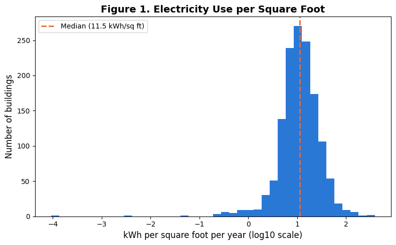
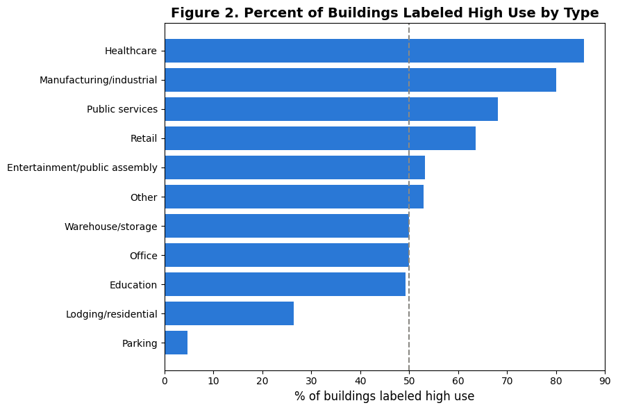
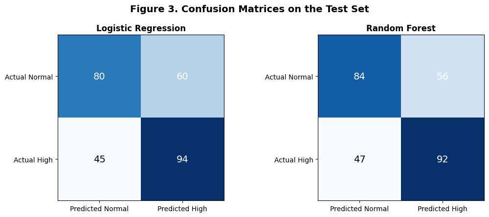
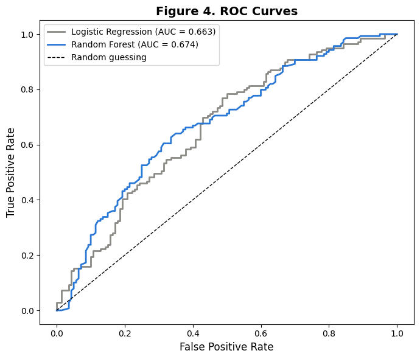
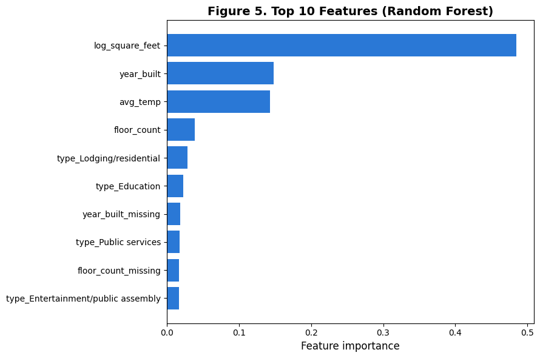

# Predicting High Energy Use Buildings

## Overview

Facility managers usually find out a building is wasting energy only when a high utility bill arrives. This project asks whether basic building information can predict which buildings use more electricity than normal **for their size**.

Bigger buildings use more energy simply because they are bigger, so instead of total energy this project uses **electricity per square foot** (kWh per square foot per year). Buildings above the median are labeled *high use* and the rest *normal*. Two classification models, logistic regression and random forest, are trained to predict the label from building type, size, age, number of floors, and local temperature.

## Key Results

| Model | 5-fold CV accuracy | Test accuracy | AUC |
|-------|-------------------|---------------|-----|
| Logistic regression | 62.1% | 62.4% | 0.663 |
| Random forest | 64.2% | 63.1% | 0.674 |

- Both models beat the 50% baseline of random guessing, but accuracy is moderate.
- The two models performed about the same, so the simpler logistic regression is a reasonable choice.
- Size was the most important feature, followed by year built and average temperature.
- Building type shows clear patterns: 86% of healthcare buildings were high use, compared to 26% of lodging and 5% of parking buildings.

**Takeaway:** building information alone is useful as a first screening step, but the actual meter data is still needed to find real problems. Much of the difference between buildings likely comes from how each one is operated, which is not in the data.

## Data

- **Source:** [ASHRAE Great Energy Predictor III](https://www.kaggle.com/c/ashrae-energy-prediction) (Kaggle)
- **Size:** 20.2 million hourly meter readings from 1,449 buildings across 16 sites in 2016, plus building details and hourly weather
- The data files are not stored in this repository because of their size (about 2.6 GB). The notebook is written to run on Kaggle with the competition data attached.

## Approach

1. **Filter:** kept electricity meters only, since every building has one
2. **Fix units:** converted one site from kBTU to kWh
3. **Clean:** removed readings stuck at zero for 48 hours or more (dead meters, 3.8% of readings) and single-hour spikes over 10 times a building's median (0.2%)
4. **Aggregate:** one row per building, yearly electricity divided by square feet
5. **Label:** above the median (11.5 kWh per square foot) is high use; 1,391 buildings split evenly
6. **Handle missing values:** year built (53% missing) and floor count were filled with the median, with a column marking which values were filled in
7. **Model:** logistic regression and random forest with an 80/20 train/test split and 5-fold cross-validation

## Visualizations

### Electricity use per square foot


### Share of high use buildings by type


### Confusion matrices


The random forest caught 92 of the 139 high use buildings in the test set (66% recall). When it predicted high use, it was right 62% of the time.

### ROC curves


### Feature importance


## Limitations

- Accuracy is moderate (about 63%), so the model should not be used on its own to make decisions.
- Year built is missing for over half of the buildings.
- Only electricity was used. Buildings heated with steam or gas may look more efficient than they are.
- Some building types, such as healthcare, naturally need more energy. A fair comparison is against buildings of the same type.
- Most buildings are on university campuses, so results may not apply to every kind of building.

## How to Run

1. Open the [competition page](https://www.kaggle.com/c/ashrae-energy-prediction) on Kaggle and create a new notebook with the competition data attached.
2. Import `notebooks/building_energy_classification.ipynb`.
3. Run all cells. It takes about 5 minutes.

To run locally instead, download the three files listed in `data/README.md` and set the `ASHRAE_DATA` environment variable to that folder.

## Repository Structure

```
building-energy-use-classification/
├── README.md
├── requirements.txt
├── data/
│   └── README.md          # where to download the data
├── images/                # figures used in this README
├── notebooks/
│   └── building_energy_classification.ipynb
└── reports/
    └── building_energy_white_paper.pdf
```

## Tools

Python, pandas, NumPy, scikit-learn, Matplotlib
